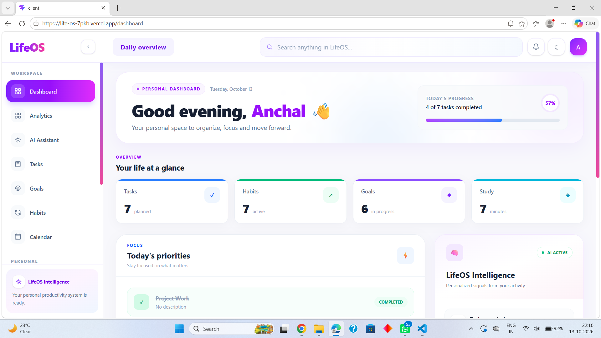
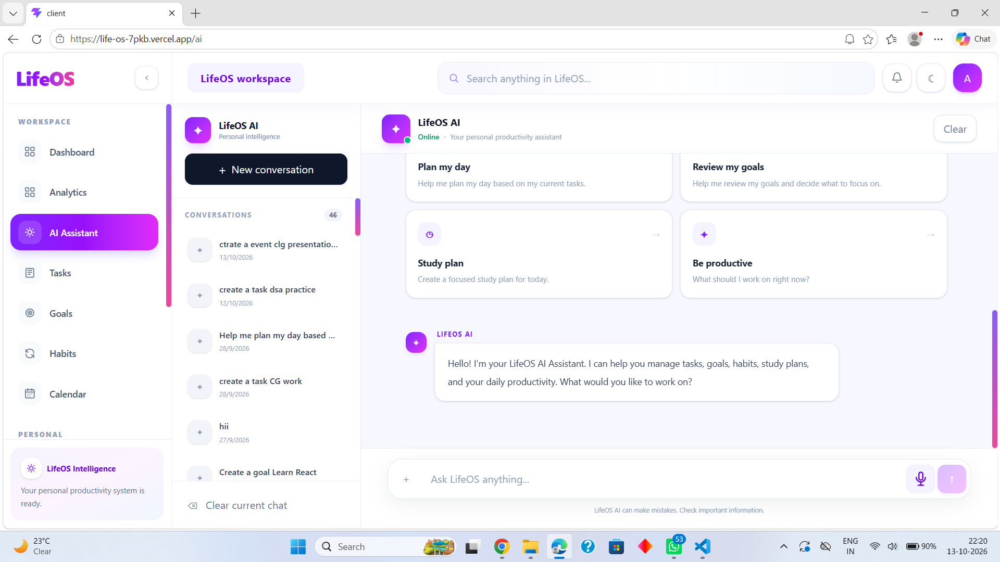
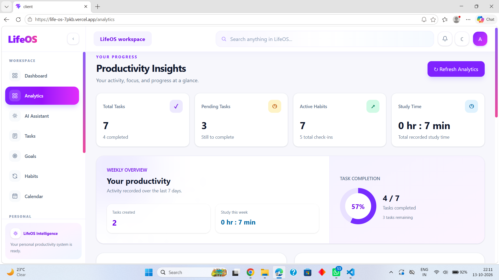
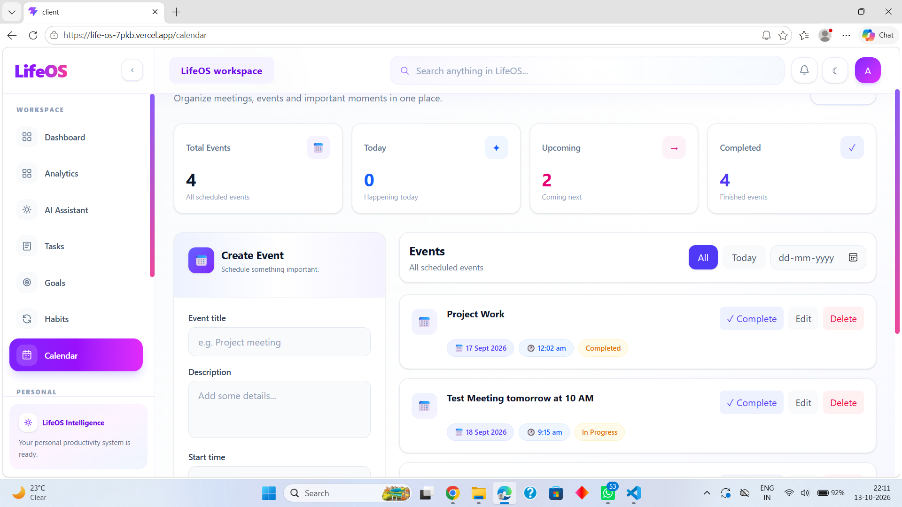

# LifeOS — Your Personal Productivity Workspace

**LifeOS** is a full-stack productivity web application designed to bring tasks, goals, habits, scheduling, notes, journaling, and other personal workspace tools together in one place.

🔗 **Live Demo:** [Open LifeOS](https://life-os-7pkb.vercel.app) 
💻 **GitHub Repository:** [View Source Code](https://github.com/Anchal-Gola/LifeOS)

## ✨ Features

- **Dashboard** — A central workspace to access productivity tools.
- **Task Manager** — Organize and manage tasks.
- **Goal Management** — Create and track personal goals.
- **Habit Tracker** — Track daily habits and build consistency.
- **Calendar** — Manage scheduled events.
- **Notes** — Create and organize notes.
- **Journal** — Record daily thoughts and reflections.
- **Study Workspace** — Keep study-related resources organized.
- **Documents** — Manage documents within the application.
- **AI Assistant** — AI-powered assistance for supported workflows.
- **Analytics** — Review available productivity statistics.
- **Notifications** — Access application notifications.
- **Authentication** — User authentication with JWT and Google Sign-In.

*Features may evolve as development continues.*

## 🛠️ Tech Stack

### Frontend
- React
- JavaScript
- Vite
- Tailwind CSS
- React Router
- Axios

### Backend
- Node.js
- Express.js
- MongoDB
- Mongoose
- JWT Authentication

### Deployment
- Frontend: Vercel
- Backend: Render
- Database: MongoDB Atlas

## 🏗️ Architecture

LifeOS follows a layered backend architecture to separate responsibilities and improve maintainability.

**Request flow:**

`Client → Route → Controller → Service → Repository → Model → MongoDB`

- **Routes:** Define API endpoints.
- **Controllers:** Handle incoming requests and responses.
- **Services:** Contain application logic.
- **Repositories:** Manage data-access operations.
- **Models:** Define database schemas.

## 🚀 Run Locally

### Prerequisites

Install the following:

- Node.js and npm
- MongoDB Atlas account or a local MongoDB instance
- Git

### 1. Clone the repository
git clone https://github.com/Anchal-Gola/LifeOS.git
cd LifeOS

### 2. Set up the backend
cd server
npm install

Create a `.env` file inside the `server` directory:
PORT=5000
MONGODB_URI=your_mongodb_connection_string
JWT_SECRET=your_secure_jwt_secret
FRONTEND_URL=http://localhost:5173
GOOGLE_CLIENT_ID=your_google_oauth_client_id
GOOGLE_CLIENT_SECRET=your_google_oauth_client_secret

Start the backend:
npm start
### 3. Set up the frontend
Open another terminal:
cd client
npm install

Create a `.env` file inside `client`:
VITE_GOOGLE_CLIENT_ID=your_google_oauth_client_id

Configure the frontend API base URL to point to your local backend at `http://localhost:5000` during local development.

Start the frontend:
npm run dev

Open `http://localhost:5173` in your browser.

## 🔐 Environment Variables

Keep credentials and secrets private.

- Never commit `.env` files.
- Never expose `GOOGLE_CLIENT_SECRET` or `JWT_SECRET` in frontend code.
- Use environment variables in Vercel and Render for production configuration.
- Configure the Google OAuth authorized origins for the appropriate frontend URL.

🎥 LifeOS Demo
    Watch the 59-second walkthrough of LifeOS:
    https://youtu.be/dQf9tPIhWFk

## 📸 Screenshots and Demo
Dashboard

AI Assistent

Analysis

Calender

**Live application:** [LifeOS](https://life-os-7pkb.vercel.app)

## 🎯 Project Goal

LifeOS aims to provide a unified productivity workspace where users can organize their work, track progress, and access useful tools through one application.

## 👩‍💻 Developer

**Anchal Gola**

- GitHub: [Anchal-Gola](https://github.com/Anchal-Gola)
- Project: [LifeOS Repository](https://github.com/Anchal-Gola/LifeOS)

---

*Built as a hands-on full-stack development project.*
